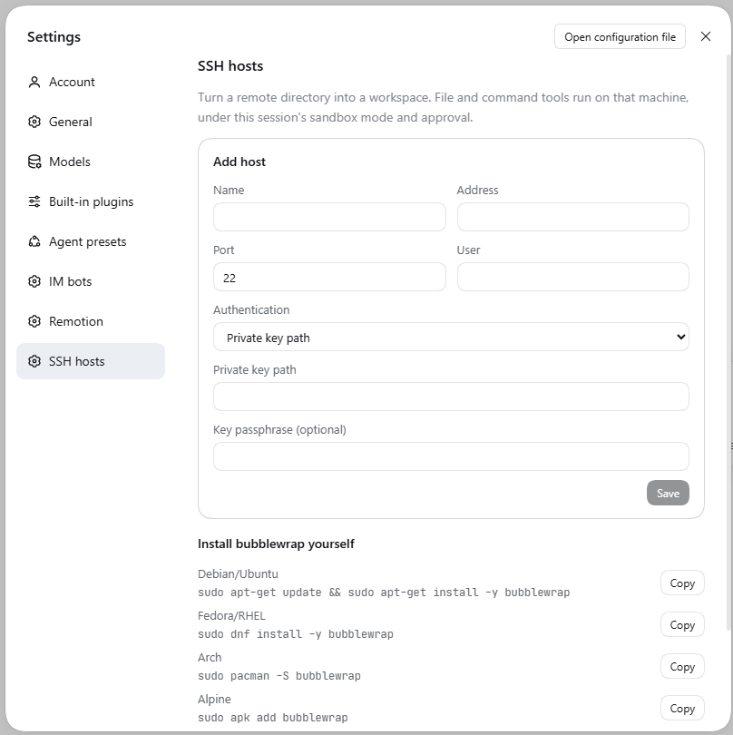

# dsh-permission-remote

把一台 Linux 或 macOS 机器上的目录做成 DeepSeek Harness（DSH）工作区。标准会话里的 `bash`、`read`、`write`、`edit`、`read_image`、`glob`、`grep` 在那台机器上执行。只读、工作区可写、完全放开，以及一次放宽，仍用这个会话现有的 Permissions 和审批卡片。

[English](#english).

## 安装

前置：DSH `>=0.2.1-rc.3 <0.3.0`、`web` profile、Node `>= 22.5`。仓库：[weicy98/dsh-permission-remote](https://github.com/weicy98/dsh-permission-remote)。

从 GitHub 安装：

```sh
dsh plugin --profile web add github:weicy98/dsh-permission-remote
```

从 npm 安装：

```sh
dsh plugin --profile web add dsh-permission-remote
```

不需要改 profile 的 `pnpm-workspace.yaml`。SSH 库随插件带上，安装时没有要批准的构建脚本。

也可以用本机目录：`dsh plugin --profile web add /绝对路径/dsh-permission-remote`。

然后重启 `dsh web` 并硬刷新页面。设置里会出现 **SSH 主机**，左侧栏上方也会多一个 **SSH 主机** 图标（在「插件」和「定时任务」之后），点它直接在中间打开同一页，右上角的「返回会话」回到对话。两个入口是同一份界面和同一份配置。



## 用法

1. **添加主机。** 从两个地方都能进来：左侧栏的 **SSH 主机** 图标，或 设置 → SSH 主机。填写地址、端口、用户，以及私钥路径或口令。口令和私钥口令只写入 DSH 凭据存储；私钥只记录本机路径。已保存的主机可以点 **编辑** 改地址、端口、用户、认证方式和运维策略；改地址或端口会清掉旧指纹，需要重新测试并信任。
2. **测试并信任。** 第一次连接会给出主机指纹。确认后再信任，随后用只读沙箱 profile 真跑一次 `true`。
3. **沙箱依赖。** Linux 上没有可用的 bubblewrap 时，可以点 **安装远端沙箱依赖**。按钮按发行版执行 `sudo -n`，避免卡在密码提示。页上同时有可复制的自行安装命令：
   - Debian/Ubuntu：`sudo apt-get update && sudo apt-get install -y bubblewrap`
   - Fedora/RHEL：`sudo dnf install -y bubblewrap`
   - Arch：`sudo pacman -S bubblewrap`
   - Alpine：`sudo apk add bubblewrap`
   - macOS 使用系统自带的 `sandbox-exec`，没有安装按钮。探测失败时，受限 bash 需要经审批把这一次升到 `danger-full-access`。
4. **ripgrep。** `glob` / `grep` 需要远端有 `rg`。连接时会按远端架构上传随插件带上的二进制。本机没有该平台的包时（典型是 Windows 上的 DSH 管 Linux 远端，包管理器只装本平台的 `@vscode/ripgrep-win32-x64`），如果远端 `$HOME/.dsh-permission-remote/rg` 已经能跑 `--version`，探测直接用它，不再下载。还没有这份文件时，主机行会出现「安装 ripgrep」：按远端平台从 npm 源下载 `@vscode/ripgrep-<platform>`，取出 `package/bin/rg` 缓存到 `$DSH_HOME/cache/ripgrep/<platform>/rg`，再重新探测；上传被远端拒绝时也用同一个按钮重试。只有点这个按钮才联网，下载源在设置页填（留空用 npmjs，可填镜像）。都不想用的话，可以在远端自己安装 ripgrep，让 `rg` 出现在 `PATH` 里。
5. **创建工作区。** 在同一页浏览远端目录，把当前目录作成工作区。点某台主机的「浏览目录」，目录面板就展开在**这台主机那一行下面**（再点一次收起），不会跑到整个列表底下；面板内再点「把当前目录做成工作区」后自动收起，新工作区直接出现在这台主机的列表里。面板上方的筛选框边打字边过滤当前已列出的名字，不发远端请求；换目录时清空，同一目录刷新时保留。**「新建文件夹」** 在筛选框下方展开一个输入行，回车即在该目录下建一级子目录，列表随即刷新、名字保留在输入框里，方便连着建几个；名字里带 `/` 或为空会被拦下，重名会照远端返回的结果提示。键盘：`/` 聚焦筛选框（只在 SSH 主机页生效，输入框里按 `/` 照常输入），↑/↓ 在目录间移动高亮，Enter 进入高亮的目录，Esc 先清空筛选、再按一次退出输入框，Home/End 跳到首尾。它会出现在原来的工作区列表里。左侧文件列表仍是本机的占位目录，远端文件要在对话的执行结果里看；右侧栏终端会连到远端，见下面「侧栏终端」。
6. **查看各台服务器的工作区。** 每台主机下面有「已添加的工作区」，列出从这台机器创建的工作区、远端目录和会话数。可以只从 DSH 列表移除（远端文件不动），也可以把侧栏标题重新标注。
7. **侧栏认主机。** DSH 的侧栏工作区行只显示标题、没有可挂标记的 slot，所以插件把主机名写进标题：`服务器 · 目录名`。加载时只标注标题仍是目录名的那些；你改过的名字不会被自动改写，可以随时用该主机下的「标注侧栏标题」手动重标——它会给该主机的全部工作区标注，并把旧服务器的前缀换成当前的。设置页的开关（`tagWorkspaceTitles`）可以整体关掉标注，重新打开时会立即标注一遍。
8. **删除与恢复主机。** 删除主机只是把它从列表移走，工作区仍然注册在 DSH 里，标题保留原前缀。设置页的「已删除的主机」分组里可以「恢复主机」（配置和指纹都还在），也可以逐个「注销工作区」。

打开这个工作区的会话后，对话和 Permissions 与本地会话相同。相对路径按远端工作目录解析。工具结果里的路径写成占位目录，模型下一轮仍用这条路径。`working_directory` 也留在这条占位路径上：切换目录会确认远端目录存在，再把会话目录改成对应的占位路径，不会改到你这台电脑上的真实目录。从**本地**会话切进远端路径时，占位目录会随着工作区注销留下来，而进了占位目录就等于拿到那台机器的远端 shell，所以插件不会只凭「目录还在」或「列表里已经有这个工作区」放行。`ssh_workspace` 和设置页都只注册工作区，不让当前会话进入；要在那台机器上工作，从侧栏打开。拒绝发生在目录写进会话之前，错误里也不写出占位路径，并说明这个会话不是从那台主机打开的。本地会话即使当前目录已经是某个已注册的占位目录，工具同样拒绝。从这台主机的工作区打开的会话不受影响——在这台机器上 `cd /etc` 照常，跨主机本来也跳不过去。`workspace-write` 的可写根钉在会话头里记下的工作区目录上，不跟着当前目录走，所以打开的会话即使 `cd /` 也不会把整台机器绑成可写。这样一来，`deny` 主机也无法靠残留的占位目录绕开「拒绝所有远端读取」。每轮的运行时上下文还会写明这条占位路径对应的远端真实目录（`Remote directory: "..."`），`working_directory` 的结果也会在占位路径下面多给一行 `(remote: /home/...)`，命令里可以直接用这条绝对路径，不必先跑 pwd。

## 主机设置：远程调用审批与环境变量来源

每台主机卡片上的两个设置都在**编辑对话框**里。卡片上平时只显示操作按钮；某一项偏离默认值时，卡片上会多出一个标签写明它，点标签直接打开编辑对话框。

### 远程调用审批（默认「每次询问」）

控制其他工作区里的会话用 `ssh_exec` / `ssh_write` 操作这台主机时放不放行：

| 选项 | 行为 |
|---|---|
| 每次询问 | 执行命令和写文件各要一次 `danger-full-access` 审批（默认） |
| 不再询问 | 直接执行，不弹卡。卡片上显示琥珀色标签「远程调用免审批」 |
| 禁止调用 | 这台主机拒绝所有远程命令和写入。卡片上显示灰色标签「远程调用已禁止」 |

读取远端文件不受这个设置影响。

### 环境变量来源（默认「SSH 登录环境」）

远端工作区里的 `bash` 用哪一套环境变量：

| 选项 | 行为 |
|---|---|
| SSH 登录环境 | 沿用 SSH 登录时拿到的变量，通常只有 `/etc/environment` 里那几个（默认） |
| 读取 bash 启动脚本 | 捕获一次启动文件导出的变量并复用。卡片上显示标签「读取 bash 启动脚本」和「重新读取环境」 |

选「读取 bash 启动脚本」后，这条 SSH 连接上的第一条工作区命令会读一次启动文件：`/etc/profile`，然后 `~/.bash_profile`、`~/.bash_login`、`~/.profile` 里第一个能读的，再是 `/etc/bash.bashrc` 和 `~/.bashrc`。前面已经 source 过的 `~/.bashrc` 和 `/etc/bash.bashrc` 不会再读。读取时丢掉这些文件的输出，最多 10 秒。超时或失败时，这次连接后面的命令继续用 SSH 原来的环境，也不会反复重试。

读到的变量会复用，直到断开连接、切回「SSH 登录环境」，或在卡片上点「重新读取环境」。重新读取只丢掉这份缓存，不断开 SSH；下一条工作区命令会再读一次，同样最多 10 秒。bashrc 里导出的 `PATH`（例如 nvm、cargo）会保留。如果 bashrc 把 `PATH` 设成了错误的值，之后的命令会一直用这份 `PATH`，直到重新读取、断开连接或切回。

`PWD`、`OLDPWD` 和 `SHLVL` 是当前会话的状态，不会进缓存。每条命令自己的 bash 再设置它们。不读取 `~/.zshrc`。别名和函数不会保留：靠 `PATH` 找到的命令会生效，靠 shell 函数的（如 `nvm`）不会。每条用户命令仍是一个新的 bash。`ssh_exec` 不受这个设置影响，它还是 `bash -lc`。


`workspace-write` 的文件写入在远端沙箱进程里完成：内容先进入同目录的临时文件，再 `mv -f` 换成目标文件。中途断开留下的是临时文件，原来的内容还在。`danger-full-access` 用同一步替换，但不包沙箱。

### 远端根目录与配置备份

设置页的「远端根目录」是本地存放所有远端工作区占位目录的位置，默认 `~/.dsh/remote`（可用 `DSH_SSH_REMOTE_ROOT` 覆盖）。把这一栏清空再保存，会回到内置默认目录。改到新目录并点「保存并迁移」时：

- 新目录不存在或是空的：把旧的 `remote` 目录整棵复制过去。
- 新目录已有内容：自动合并——缺失的补上、完全相同的跳过、同名但内容不同的文件先不覆盖，页面上会问你要「保留目标（自动合并）」还是「用旧目录覆盖」。同名但一侧是目录、另一侧是文件的情况一律不动，会列在冲突里，由你手工处理。符号链接按链接原样复制、不跟随；目标里已有的符号链接保持不动并列为冲突，避免写穿链接。
- 新目录不能放在旧目录里面（反过来也不行），否则直接报错，不会开始复制。
- 工作区里有打开着的会话时，会先提示；迁移会按远端路径把这些工作区重新注册到新占位目录下，正在进行的会话需要重新打开。

旧目录不会被删除，确认无误后可自行清理；迁移只搬本机的占位目录，不动远端服务器上的文件。若在通用设置编辑器里直接改这个值，会立即生效但**不会**迁移旧目录——要搬目录仍请用「保存并迁移」。本次运行期间，旧目录里的路径仍按「远端占位目录」解析——挂在旧占位目录上的会话还能继续连到那台服务器；但旧目录里没有已注册工作区覆盖时，会明确报错拒绝，而不是悄悄变成本地目录。重启后旧目录不再被识别。

设置页还有「主机配置备份」：**导出配置**把主机列表存成 JSON（不含口令和私钥口令，它们只在凭据存储里）；**导入并合并**按主机 id 更新或新增，且只更新文件里真正写了的字段——只改名字的行会保留指纹、私钥路径和审批策略；地址变了会丢掉已保存的口令，文件没给新指纹时会清掉旧主机密钥。**导入并替换**用文件整体替换现有列表（会先确认一次；文件里没有的主机会移到「已删除主机」，可以恢复）；之前已删除、但仍有工作区的主机，即使文件没提到也会保留在「已删除主机」里。合并只并入主机行，不采用文件里的「已删除主机」记录。导入后请重新测试连接，并按需重填口令；文件里设为 `trust` 的主机会在结果里提示数量。若文件改动现有主机的地址、把主机设为 `trust`，或把 `deny` 放宽成 `ask`，页面会先询问再导入；文件新增的主机直接生效。

## 权限

| 档位 | 文件写入 | bash |
|---|---|---|
| `read-only` | 拒绝 | 有可用 runner 时在约束下执行；没有则 `SANDBOX_UNAVAILABLE`，命令不跑 |
| `workspace-write` | 只允许打开时的工作区根和远端临时目录 | 同上。可写根不跟着 `cd` 变。bubblewrap 的 `/tmp` 是私有 tmpfs；文件工具写的是真实临时目录 |
| `danger-full-access` | 按远端登录用户执行 | 不包壳。没有 runner 时，停掉任务可能收不齐子孙进程 |

模型带 `sandbox_permissions` 和一句话理由重试时，仍走现有审批。批准只放宽这一次调用。

## 远程运维

普通工作区（目录在你这台电脑上）也可以让模型操作一台已配置的 SSH 主机，用来查日志、重启服务、改配置，或者把远端目录注册成工作区。打开会话即可看到五个工具：

| 工具 | 作用 |
|---|---|
| `ssh_hosts` | 列出主机 id、名称、地址、用户、运维策略和指纹是否已信任 |
| `ssh_exec` | 在那台机器上执行 `bash -lc`，可选绝对路径 `workdir` 和 `timeoutMs` |
| `ssh_read` | 读取远端文件，1 MiB 上限，按行分页；支持 `~/` |
| `ssh_write` | 用临时文件加 `mv -f` 原子替换远端文件。已有文件保留权限位，新文件按远端 umask 创建，目录路径会被拒绝 |
| `ssh_workspace` | 给某台已有主机、以某个远端目录创建一个工作区。目录必须已经存在且是目录，不能是文件系统根 `/`。标题默认取目录名，开了标题标注时会带上服务器前缀。重复添加同一目录不会产生第二行，保留原标题，结果里会说明 |

每台主机在设置里有一个**远程运维**策略：

| 策略 | 读取 `ssh_read` | 命令 `ssh_exec` / 写入 `ssh_write` / 添加工作区 `ssh_workspace` |
|---|---|---|
| 询问（默认） | 允许 | 只在本会话是 `danger-full-access` 时直接执行；否则第一次被拒，模型必须带 `sandbox_permissions: "danger-full-access"` 和理由重试后弹审批卡。卡片上有主机和截断后的命令或路径，批准只放宽这一次。其它档位不会弹卡 |
| 信任 | 允许 | 直接执行，不弹审批 |
| 禁止 | 拒绝 | 拒绝 |

`ssh_exec`、`ssh_write` 和 `ssh_workspace` 在远端不受远端工作区沙箱约束，因为运维目标通常是本机工作区之外的机器。它们要么走当前会话的 `danger-full-access`，要么走这台主机的信任策略，要么走一次审批。读取只受「禁止」限制。

`ssh_workspace` 做一次远端 `stat`，再按远端真实路径注册（符号链接记成它指向的目录，标题默认取这个真实路径的目录名）。`realpath` 失败则这次注册失败。它不改远端文件。它只在侧栏加一条工作区。打开这条工作区会在那台机器上开始一个会话，所以询问策略下仍和命令一样要审批。这次调用不让当前会话进入，结果里也不给出占位目录。要在那台机器上工作，从侧栏打开。文件系统根 `/` 不能注册，真实路径解析成 `/` 时同样拒绝：那一棵会盖住整台机器。对同一个远端真实路径重复添加不会产生第二行，保留已有的标题，结果里会说明它已经注册过。

运维工具的前提：

- 目标主机必须已经在设置里信任过指纹，否则连接失败
- `ssh_exec` 用 `bash -lc`，会读登录 shell 的 profile，这样 `PATH` 里才有 `systemctl`、`docker` 这类命令；profile 若往 stdout 打东西，会出现在命令输出里
- `sudo` 只能走免密（`sudo -n`）。SSH 非交互执行没有 TTY，需要口令的 `sudo` 会卡住
- 只支持直连的 Linux 或 macOS；不支持跳板机和 Windows 远端
- 目前没有上传和下载工具
- 网络中断时，正在执行的远端命令会失败；已经写入的文件留在远端，不会回滚

## 侧栏终端

在远端工作区里，右侧栏的终端连的是那台服务器，不是你这台电脑：新建终端时 shell 菜单里列的是远端 `$SHELL` 和远端装了的 `bash` / `zsh` / `fish` / `sh`，标签名带主机名（`lo · zsh`）。缩放、滚屏、复制、刷新页面后重连都由 DSH 原来的终端界面负责。

几点要注意：

- **权限。** 侧栏终端是远端登录用户自己的 shell，和本地会话里的侧栏终端一样**不套 bubblewrap**，也不按按键走 Agent 审批。闸门只有「这台主机的指纹已经信任」。要按当前权限档位跑命令，用对话里的 `bash` 工具。
- **连接是共享的。** 一个标签页一条 SSH 通道，和文件传输、远端命令共用这台主机的那一条连接。OpenSSH 默认 `MaxSessions 10`，而 DSH 每个会话最多 8 个终端。通道占满时新标签页会报这台主机拒绝再开一个 SSH 会话；只关侧栏终端不一定腾得出名额，也可以在远端调高 `MaxSessions`。
- **不跟随后续的 `working_directory`。** 已经开着的终端留在打开时那个远端目录；新开的用当时的目录。占位子目录不存在时，新建终端会先把它建出来，这样不会退回工作区根。建不出来时仍由 DSH 退回工作区根。
- **断线即结束。** 连接断了终端就结束，不会自动重连，也没有回滚：关掉标签页重开一个即可。
- **只有侧栏接上了。** 模型侧的 `terminal_open` 在远端工作区里会直接报错并提示改用 `bash` 或侧栏终端——它请求的是本机 PTY 后端，会把 shell 开在你这台电脑的占位目录里。`terminal_send` / `terminal_read` / `terminal_list` 不动：它们操作的是已经存在的终端。

## 使用上要注意

对话里的读文件、改文件、搜索和运行命令发生在远端。左侧的文件列表还是本机的占位目录，里面看不到远端工程；右侧栏终端见上一节，它连的是远端。

DSH 本身跑在 Windows 上时，远端工作区的对话只暴露远端 `bash`。`pwsh`、`powershell`、`cmd` 不会出现在原生工具列表里，官方那段 Windows 进程结束说明（`tool:pwsh`）在停在这个工作区时也会被盖住。回到本机目录后，这些 Windows 工具和原来的说明恢复。`minimal` 这类把提示词写成完整 persona 的预设不会被改写；挡住 Windows shell 的是工具列表过滤和执行守卫。内置预设的 `pwsh` 在祖先层，进入远端时会被从原生工具列表和 `ptc` SDK 正文里去掉。注册在 agent 本层的 `pwsh` 去不掉：SDK 正文仍可能列出它，原生列表会被滤掉，调用会被拒绝。文件工具的参数继续用工具返回的占位路径。

模型用「运行代码」，或者会话要读取项目里的 `AGENTS.md` 时，读到的也是你电脑上的这个工作区目录，不是远端那一份。

目前只能直接连接一台 Linux 或 macOS。不能经跳板机连接，也不能把 Windows 当作远端。网络中断时，正在进行的操作会失败。已经写到远端的文件会留在那里：重新连上之后不会再写一遍，也不会自动撤回。远程工作区里的 `bash`、`read`、`write`、`edit` 只能操作那台机器；要在当前本地工作区操作另一台主机，用上面的 `ssh_hosts` / `ssh_exec` / `ssh_read` / `ssh_write` / `ssh_workspace`。

Linux 上要让命令遵守当前权限，需要在那台机器上安装 bubblewrap。设置页可以代为安装，页面上也有可以自己执行的命令。

## 开发

```sh
npm install
npm test
npm run typecheck
npm run build
```

`lib/` 是安装入口，改完源码需要重新构建。

## English

SSH remote workspaces for the DSH web GUI. On a workspace created from **Settings → SSH hosts**, the standard tools `bash`, `read`, `write`, `edit`, `read_image`, `glob`, and `grep` run on that Linux or macOS host. The session keeps its existing Permissions selector and approval card.

Requires DSH `>=0.2.1-rc.3 <0.3.0`, the `web` profile, and Node `>= 22.5`. Source: [weicy98/dsh-permission-remote](https://github.com/weicy98/dsh-permission-remote).

From GitHub:

```sh
dsh plugin --profile web add github:weicy98/dsh-permission-remote
```

From npm:

```sh
dsh plugin --profile web add dsh-permission-remote
```

No `pnpm-workspace.yaml` edit. The SSH library ships inside the plugin, so install does not ask to approve a build script.

A local checkout also works: `dsh plugin --profile web add /absolute/path/to/dsh-permission-remote`.

Restart `dsh web` and hard-refresh. **SSH hosts** appears in Settings, and an **SSH hosts** icon joins the top of the left sidebar (after Plugins and the task manager): it opens the same page in the centre column, and **Back to session** at the top right returns to the conversation. Both entries are one UI over one configuration. Add a host, trust its fingerprint, then browse a remote directory and create a workspace. **Browse** opens the picker inside that host's row, right under the button you pressed (press it again to close), not below the whole list. Creating a workspace closes the picker so the new row is visible. A filter box above the listing narrows the listed names as you type, without a remote round trip; it clears when you walk to another directory and survives a refresh of the same one. **New folder** opens an input row under the filter and creates one child directory of the listed one on Enter: the listing refreshes in place and the name stays in the field, so several folders can be made in a row. A name containing `/` or an empty one is refused; a duplicate is reported from the remote's own reply. Keyboard: `/` focuses the filter (only on the SSH hosts page, and a literal `/` still types inside any field), ↑/↓ move the highlight, Enter opens the highlighted directory, Esc clears the query first and then leaves the box, Home/End jump to the ends. Passwords stay in the DSH credential store. Private keys are referenced by local path. A saved host can be **edited** to change its address, port, user, authentication, or ops policy; changing the address or port clears the stored fingerprint, so trust the new host key again.

Each host lists the workspaces created from it, with the remote directory and session count. Unregistering removes the row from DSH only; files on the host stay. DSH renders a sidebar workspace row from its title and exposes no slot on that row, so the plugin writes the server into the title as `server · directory`. Load-time tagging touches only titles that are still the directory name; a name you changed is left alone, and each host has a “Tag sidebar titles” button that prefixes every workspace under it, replacing an old server prefix. The Settings switch (`tagWorkspaceTitles`) turns tagging off entirely; turning it back on labels the existing workspaces right away.

Deleting a host only removes it from the list: its workspaces stay registered with their old title prefix. The “Deleted hosts” group in Settings can restore the host (configuration and fingerprint are kept) or unregister its workspaces one by one.

`working_directory` stays on the placeholder path for that remote directory. From a **local** session, entering a remote path is not authorized by a leftover placeholder, by a workspace that merely exists in the list, or by `ssh_workspace`. Registration only adds the sidebar row; start a session there by opening that workspace. The plugin refuses before the session directory changes. The error does not include the placeholder path, and it says this session was not opened on that host. A local session whose current directory is already a registered placeholder is refused the same way. A session **opened** on that host keeps working — `cd /etc` is ordinary navigation there, and routing cannot cross hosts — so a leftover placeholder can no longer be used to read a `deny` host. Under `workspace-write`, the writable root stays the workspace encoded in the header. It does not follow the live directory, so `cd /` does not bind the whole machine. Every turn's runtime context also names the real remote directory that placeholder maps to (`Remote directory: "..."`), and the `working_directory` result adds a second line `(remote: /home/...)` under the placeholder, so a command can use the absolute path without running `pwd` first. Under `workspace-write`, the confined command writes a temp file in the same directory and `mv -f` replaces the target, so a dropped connection does not truncate the original. `danger-full-access` uses the same replace without confinement.

Linux bash confinement needs bubblewrap. The settings page can install it with `sudo -n`, and also shows the manual command for Debian, Fedora, Arch, and Alpine. macOS uses the system `sandbox-exec`.

`glob` and `grep` need ripgrep on the remote; the plugin uploads a matching binary when it has one. A package manager installs only its own platform's package, so a Windows DSH managing a Linux remote has no Linux binary to upload. A binary already at `$HOME/.dsh-permission-remote/rg` that runs `--version` is used as-is. Otherwise the host row offers “Install ripgrep”: it downloads `@vscode/ripgrep-<platform>` for the remote from the configured npm source (empty means npmjs; a mirror works), takes `package/bin/rg` out of the tarball, caches it at `$DSH_HOME/cache/ripgrep/<platform>/rg`, and re-probes. The same button retries after a remote refused the upload. Nothing reaches the network unless that button is pressed. Alternatively install ripgrep on the remote so `rg` is on `PATH`.

## Per-host settings: remote call approval and environment source

Both settings live in the **edit dialog**. The card normally shows only actions; when one of them leaves its default, the card gains a label naming it, and clicking that label opens the dialog.

### Remote call approval (default: ask each time)

Controls whether a session in another workspace may use `ssh_exec` / `ssh_write` against this host:

| Option | Behaviour |
|---|---|
| Ask each time | Each command and each write needs one `danger-full-access` approval (default) |
| Do not ask | Runs directly with no prompt. The card shows an amber label: remote calls need no approval |
| Block calls | This host refuses every remote command and write. The card shows a grey label: remote calls blocked |

Reading remote files is not affected by this setting.

### Environment source (default: SSH login environment)

Which variables a remote workspace's `bash` runs with:

| Option | Behaviour |
|---|---|
| SSH login environment | Keeps what SSH logged in with, usually just the few in `/etc/environment` (default) |
| Read bash startup files | Captures the variables the startup files export once, and reuses them. The card shows the label plus Re-read environment |

With Read bash startup files, the first workspace command on that SSH connection reads `/etc/profile`, the first readable of `~/.bash_profile`, `~/.bash_login`, and `~/.profile`, then `/etc/bash.bashrc` and `~/.bashrc`. A `~/.bashrc` or `/etc/bash.bashrc` that an earlier file already sourced is not read again. Output from those files is discarded. Reading stops after 10 seconds. If it times out or fails, later commands on this connection keep the SSH environment and the read is not retried.

The variables are reused until the connection drops, the switch goes back to SSH login environment, or Re-read environment is pressed on the card. Re-reading drops only the cache and leaves the SSH connection up; the next workspace command reads the files again, with the same 10 second cap. `PATH` exported by bashrc, such as nvm or cargo, is kept. A bashrc that sets a bad `PATH` keeps that `PATH` for later commands until re-read, disconnect, or switching back.

`PWD`, `OLDPWD`, and `SHLVL` are session state and are not cached. Each command's own bash sets them. `~/.zshrc` is not read. Aliases and functions are not kept: commands found through `PATH` work, shell functions such as `nvm` do not. Each user command is still a fresh bash. `ssh_exec` ignores this setting and stays `bash -lc`.

In the conversation, reading, editing, searching, and shell commands run on the remote machine. The file list on the left is still the local placeholder directory.

When DSH itself is running on Windows, a remote workspace exposes only the remote `bash` tool. `pwsh`, `powershell`, and `cmd` stay off the native tool list, and the static `tool:pwsh` note about Windows process termination is covered while the session remains on that workspace. Returning to a local directory restores those Windows tools and the original note. A `complete: true` persona such as `minimal` is not rewritten; the tool-list filter and an execution guard keep the Windows shells from running. A built-in preset's `pwsh` sits on an ancestor scope, so entering a remote workspace removes it from the native tool list and from the `ptc` SDK text. A `pwsh` registered on the agent scope itself cannot be removed that way: the SDK text may still name it, the native list is filtered, and the call is denied. File-tool arguments keep the placeholder paths the tools already return.

### Remote root directory and config backup

The Settings page's **Remote root directory** is where every remote-workspace placeholder lives on this machine. It defaults to `~/.dsh/remote` (overridable with `DSH_SSH_REMOTE_ROOT`). Clearing the field and saving goes back to the default. Pressing **Save and migrate** with a new directory:

- copies the whole old `remote` tree when the target is absent or empty;
- merges when the target already has content: missing entries are added, identical files skipped, and a same-named file with different content is left alone until you choose **Keep target (auto-merge)** or **Overwrite from old root**. A name that is a directory on one side and a file on the other is never replaced; it is listed as a conflict for you to resolve by hand. A symlink is copied as a symlink and is never followed; a symlink already in the target is left untouched and listed as a conflict, so the copy cannot write through it;
- refuses a target inside the old root (or the old root inside the target) before copying anything.

If a workspace has a live session the page asks first; the migration re-registers those workspaces under the new placeholder paths, so their sessions must be reopened. The old directory is kept, so you can delete it once you are happy; only the local placeholder tree moves, and files on the remote servers are untouched. Editing the value in the generic settings editor takes effect immediately but does **not** migrate the old tree; use **Save and migrate** for that. For the rest of this process the old paths still read as remote placeholders, so a session left on one keeps talking to its server — and a placeholder no registered workspace covers is refused instead of quietly becoming a local directory. After a restart the old directory is no longer recognised.

**Host configuration backup** exports the host list as JSON with no passwords or key passphrases (those live only in the credential store). **Import and merge** updates or adds by host id, and only the fields the file actually contains: a row that only renames a host keeps its fingerprint, private-key path, and ops policy. A changed address drops the saved password and, when the file does not include a new fingerprint, clears the old host key. **Import and replace** makes the file the whole list, asks first, and moves hosts the file drops to **deleted hosts** so they can be restored. A host that was already deleted and still has workspaces stays in that list even when the file does not mention it. A merge takes host rows only and ignores the file's deleted-host records. After importing, test the connections again and re-enter secrets as needed; hosts set to `trust` in the file are reported by count. If the file changes an existing host's address, sets that host to `trust`, or relaxes `deny` to `ask`, the page asks before importing. A host the file adds is applied immediately.

### Sidebar terminal

The right sidebar's terminal on a remote workspace connects to that host, not to your computer: the shell menu lists the remote `$SHELL` plus whichever of `bash`, `zsh`, `fish`, and `sh` the host has, and each tab is named after the server (`lo · zsh`). Resize, scrollback, copy, and reattachment after a page reload stay with DSH's own terminal UI.

- **Permissions.** A sidebar terminal is the remote login user's own shell. Like the local sidebar terminal it is **not** wrapped in bubblewrap and does not prompt per keystroke; the only gate is a trusted host fingerprint. Use the `bash` tool when a command should follow the session's permission mode.
- **One shared connection.** Each tab is one SSH channel on this host's single connection, shared with file transfer and remote commands. OpenSSH defaults to `MaxSessions 10` and DSH allows 8 terminals per session. A full connection makes the next tab fail because the host refused another SSH session; closing a sidebar terminal may not free a slot. Raise `MaxSessions` on the remote when it does not.
- **No follow on `working_directory`.** An open terminal keeps the remote directory it started in; a new tab uses the current one. A missing placeholder subdirectory is created before the terminal opens, so the session does not fall back to the workspace root. If that directory cannot be created, DSH restores the workspace root as usual.
- **A dropped connection ends the terminal.** There is no reconnect and no rollback; open a new tab.
- **Sidebar only.** `terminal_open` refuses in a remote workspace and points at `bash` or the sidebar terminal: it asks the local PTY backend for a shell, which would open on your own computer inside the placeholder directory. `terminal_send`, `terminal_read`, and `terminal_list` are untouched; they operate on terminals that already exist.

### Remote ops from an ordinary workspace

A workspace whose directory is on your own computer can also act on a configured SSH host. Every session gets five tools:

| Tool | Purpose |
|---|---|
| `ssh_hosts` | List host id, name, address, user, ops policy, and whether the host key is trusted |
| `ssh_exec` | Run `bash -lc` on that host, with optional absolute `workdir` and `timeoutMs` |
| `ssh_read` | Read a remote file, capped at 1 MiB, paginated by line; `~/` is expanded |
| `ssh_write` | Replace a remote file atomically with a temp file and `mv -f`. An existing file keeps its permission bits, a new file uses the remote umask, and a directory path is rejected |
| `ssh_workspace` | Add a workspace for an existing host from one remote directory. The directory must already exist and be a directory, and it cannot be the filesystem root `/`. The title defaults to its name, carrying the server prefix when title tagging is on. Registering the same directory again keeps the existing row and its title, and the result says so |

Each host has a **Remote ops** policy in Settings:

| Policy | `ssh_read` | `ssh_exec` / `ssh_write` / `ssh_workspace` |
|---|---|---|
| Ask (default) | allowed | runs only when the session is `danger-full-access`; otherwise the first call is denied and a retry must pass `sandbox_permissions: "danger-full-access"` plus a justification. The approval card names the host and the truncated command or path, and grants this one call. Any other mode does not open a card |
| Trust | allowed | runs without a prompt |
| Deny | denied | denied |

Ops commands, writes, and workspace registration are not wrapped in the remote workspace sandbox, because the target is usually a machine outside your local workspace. They need the session's `danger-full-access`, a trusted host, or a one-shot approval. Reads are only limited by Deny.

`ssh_workspace` does one remote `stat`, then registers the remote real path (a symlink is stored as its target, and the default title is that real path's directory name). A `realpath` failure fails the registration. It does not modify remote files. It only adds a sidebar workspace. Opening that workspace starts a session on that machine, which is why an ask host still requires the same approval as a command. This call does not let the current session enter, and the placeholder path is not returned. Start a session there by opening the workspace from the sidebar. The filesystem root `/` is refused, including when the real path is `/`, because that one workspace would cover the whole machine. Registering the same real path again keeps the existing row and its title, and the result says so.

Requirements: the host fingerprint must already be trusted; `ssh_exec` runs `bash -lc`, so the login profile is sourced to get `systemctl`, `docker`, and similar commands on `PATH` (profile output lands in the command output); `sudo` works only without a password prompt (`sudo -n`) because SSH exec has no TTY; direct Linux or macOS only, with no jump hosts or Windows remotes; no upload or download tools yet. If the network drops, the running command fails and files already written stay on the remote.

Run Code, and the session's reading of `AGENTS.md`, also use the workspace directory on your computer, not the copy on the remote host.

You can connect directly to one Linux or macOS machine. Jump hosts and Windows remotes are not supported. If the network drops, the operation in progress fails. Files already written on the remote stay there: reconnecting does not write them again and does not undo them.

On Linux, install bubblewrap on that machine if commands should follow the current permission mode. The settings page can install it, and it also shows the command you can run yourself.
