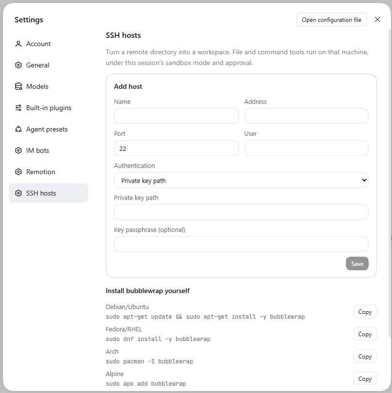

# dsh-permission-remote

把一台 Linux 或 macOS 机器上的目录做成 DeepSeek Harness（DSH）工作区。标准会话里的 `bash`、`read`、`write`、`edit`、`read_image`、`glob`、`grep` 在那台机器上执行。只读、工作区可写、完全放开，以及一次放宽，仍用这个会话现有的 Permissions 和审批卡片。

[English](#english).

## 安装

前置：DSH `0.2.1-rc.3`、`web` profile、Node `>= 22.5`。仓库：[weicy98/dsh-permission-remote](https://github.com/weicy98/dsh-permission-remote)。

从 GitHub 安装：

```sh
dsh plugin --profile web add github:weicy98/dsh-permission-remote
```

从 npm 安装：

```sh
dsh plugin --profile web add dsh-permission-remote
```

不需要改 profile 的 `pnpm-workspace.yaml`。SSH 库随插件带上，安装时没有要批准的构建脚本。

也可以用本机目录：`dsh plugin --profile web add /绝对路径/dsh-permission-remote`。

然后重启 `dsh web` 并硬刷新页面。设置里会出现 **SSH 主机**。



## 用法

1. **添加主机。** 设置 → SSH 主机。填写地址、端口、用户，以及私钥路径或口令。口令和私钥口令只写入 DSH 凭据存储；私钥只记录本机路径。已保存的主机可以点 **编辑** 改地址、端口、用户、认证方式和运维策略；改地址或端口会清掉旧指纹，需要重新测试并信任。
2. **测试并信任。** 第一次连接会给出主机指纹。确认后再信任，随后用只读沙箱 profile 真跑一次 `true`。
3. **沙箱依赖。** Linux 上没有可用的 bubblewrap 时，可以点 **安装远端沙箱依赖**。按钮按发行版执行 `sudo -n`，避免卡在密码提示。页上同时有可复制的自行安装命令：
   - Debian/Ubuntu：`sudo apt-get update && sudo apt-get install -y bubblewrap`
   - Fedora/RHEL：`sudo dnf install -y bubblewrap`
   - Arch：`sudo pacman -S bubblewrap`
   - Alpine：`sudo apk add bubblewrap`
   - macOS 使用系统自带的 `sandbox-exec`，没有安装按钮。探测失败时，受限 bash 需要经审批把这一次升到 `danger-full-access`。
4. **ripgrep。** `glob` / `grep` 需要远端有 `rg`。连接时会按远端架构上传随插件带上的二进制。本机没有该平台的包时（典型是 Windows 上的 DSH 管 Linux 远端，包管理器只装本平台的 `@vscode/ripgrep-win32-x64`），主机行会出现「安装 ripgrep」：按远端平台从 npm 源下载 `@vscode/ripgrep-<platform>`，取出 `package/bin/rg` 缓存到 `$DSH_HOME/cache/ripgrep/<platform>/rg`，再重新探测；上传被远端拒绝时也用同一个按钮重试。只有点这个按钮才联网，下载源在设置页填（留空用 npmjs，可填镜像）。都不想用的话，可以在远端自己安装 ripgrep，让 `rg` 出现在 `PATH` 里。
5. **创建工作区。** 在同一页浏览远端目录，把当前目录作成工作区。它会出现在原来的工作区列表里。左侧文件列表和终端仍显示你这台电脑上的目录，远端文件要在对话的执行结果里看。
6. **查看各台服务器的工作区。** 每台主机下面有「已添加的工作区」，列出从这台机器创建的工作区、远端目录和会话数。可以只从 DSH 列表移除（远端文件不动），也可以把侧栏标题重新标注。
7. **侧栏认主机。** DSH 的侧栏工作区行只显示标题、没有可挂标记的 slot，所以插件把主机名写进标题：`服务器 · 目录名`。加载时只标注标题仍是目录名的那些；你改过的名字不会被自动改写，可以随时用该主机下的「标注侧栏标题」手动重标——它会给该主机的全部工作区标注，并把旧服务器的前缀换成当前的。设置页的开关（`tagWorkspaceTitles`）可以整体关掉标注，重新打开时会立即标注一遍。
8. **删除与恢复主机。** 删除主机只是把它从列表移走，工作区仍然注册在 DSH 里，标题保留原前缀。设置页的「已删除的主机」分组里可以「恢复主机」（配置和指纹都还在），也可以逐个「注销工作区」。

打开这个工作区的会话后，对话和 Permissions 与本地会话相同。相对路径按远端工作目录解析。工具结果里的路径写成占位目录，模型下一轮仍用这条路径。`working_directory` 也留在这条占位路径上：切换目录会确认远端目录存在，再把会话目录改成对应的占位路径，不会改到你这台电脑上的真实目录。

`workspace-write` 的文件写入在远端沙箱进程里完成：内容先进入同目录的临时文件，再 `mv -f` 换成目标文件。中途断开留下的是临时文件，原来的内容还在。`danger-full-access` 用同一步替换，但不包沙箱。

## 权限

| 档位 | 文件写入 | bash |
|---|---|---|
| `read-only` | 拒绝 | 有可用 runner 时在约束下执行；没有则 `SANDBOX_UNAVAILABLE`，命令不跑 |
| `workspace-write` | 只允许远端工作区和远端临时目录 | 同上。bubblewrap 的 `/tmp` 是私有 tmpfs；文件工具写的是真实临时目录 |
| `danger-full-access` | 按远端登录用户执行 | 不包壳。没有 runner 时，停掉任务可能收不齐子孙进程 |

模型带 `sandbox_permissions` 和一句话理由重试时，仍走现有审批。批准只放宽这一次调用。

## 远程运维

普通工作区（目录在你这台电脑上）也可以让模型操作一台已配置的 SSH 主机，用来查日志、重启服务、改配置。打开会话即可看到四个工具：

| 工具 | 作用 |
|---|---|
| `ssh_hosts` | 列出主机 id、名称、地址、用户、运维策略和指纹是否已信任 |
| `ssh_exec` | 在那台机器上执行 `bash -lc`，可选绝对路径 `workdir` 和 `timeoutMs` |
| `ssh_read` | 读取远端文件，1 MiB 上限，按行分页；支持 `~/` |
| `ssh_write` | 用临时文件加 `mv -f` 原子替换远端文件。已有文件保留权限位，新文件按远端 umask 创建，目录路径会被拒绝 |

每台主机在设置里有一个**远程运维**策略：

| 策略 | 读取 `ssh_read` | 命令 `ssh_exec` / 写入 `ssh_write` |
|---|---|---|
| 询问（默认） | 允许 | 只在本会话是 `danger-full-access` 时直接执行；否则第一次被拒，模型必须带 `sandbox_permissions: "danger-full-access"` 和理由重试后弹审批卡。卡片上有主机和截断后的命令或路径，批准只放宽这一次。其它档位不会弹卡 |
| 信任 | 允许 | 直接执行，不弹审批 |
| 禁止 | 拒绝 | 拒绝 |

`ssh_exec` 和 `ssh_write` 在远端不受远端工作区沙箱约束，因为运维目标通常是本机工作区之外的机器。它们要么走当前会话的 `danger-full-access`，要么走这台主机的信任策略，要么走一次审批。读取只受「禁止」限制。

运维工具的前提：

- 目标主机必须已经在设置里信任过指纹，否则连接失败
- `ssh_exec` 用 `bash -lc`，会读登录 shell 的 profile，这样 `PATH` 里才有 `systemctl`、`docker` 这类命令；profile 若往 stdout 打东西，会出现在命令输出里
- `sudo` 只能走免密（`sudo -n`）。SSH 非交互执行没有 TTY，需要口令的 `sudo` 会卡住
- 只支持直连的 Linux 或 macOS；不支持跳板机和 Windows 远端
- 目前没有上传和下载工具
- 网络中断时，正在执行的远端命令会失败；已经写入的文件留在远端，不会回滚

## 使用上要注意

对话里的读文件、改文件、搜索和运行命令发生在远端。左侧的文件列表和终端还是你自己的电脑，里面看不到远端工程。

模型用「运行代码」，或者会话要读取项目里的 `AGENTS.md` 时，读到的也是你电脑上的这个工作区目录，不是远端那一份。

目前只能直接连接一台 Linux 或 macOS。不能经跳板机连接，也不能把 Windows 当作远端。网络中断时，正在进行的操作会失败。已经写到远端的文件会留在那里：重新连上之后不会再写一遍，也不会自动撤回。远程工作区里的 `bash`、`read`、`write`、`edit` 只能操作那台机器；要在当前本地工作区操作另一台主机，用上面的 `ssh_hosts` / `ssh_exec` / `ssh_read` / `ssh_write`。

Linux 上要让命令遵守当前权限，需要在那台机器上安装 bubblewrap。设置页可以代为安装，页面上也有可以自己执行的命令。

## 开发

```sh
npm install
npm test
npm run typecheck
npm run build
```

`lib/` 是安装入口，改完源码需要重新构建。

## English

SSH remote workspaces for the DSH web GUI. On a workspace created from **Settings → SSH hosts**, the standard tools `bash`, `read`, `write`, `edit`, `read_image`, `glob`, and `grep` run on that Linux or macOS host. The session keeps its existing Permissions selector and approval card.

Requires DSH `0.2.1-rc.3`, the `web` profile, and Node `>= 22.5`. Source: [weicy98/dsh-permission-remote](https://github.com/weicy98/dsh-permission-remote).

From GitHub:

```sh
dsh plugin --profile web add github:weicy98/dsh-permission-remote
```

From npm:

```sh
dsh plugin --profile web add dsh-permission-remote
```

No `pnpm-workspace.yaml` edit. The SSH library ships inside the plugin, so install does not ask to approve a build script.

A local checkout also works: `dsh plugin --profile web add /absolute/path/to/dsh-permission-remote`.

Restart `dsh web` and hard-refresh. Add a host, trust its fingerprint, then browse a remote directory and create a workspace. Passwords stay in the DSH credential store. Private keys are referenced by local path. A saved host can be **edited** to change its address, port, user, authentication, or ops policy; changing the address or port clears the stored fingerprint, so trust the new host key again.

Each host lists the workspaces created from it, with the remote directory and session count. Unregistering removes the row from DSH only; files on the host stay. DSH renders a sidebar workspace row from its title and exposes no slot on that row, so the plugin writes the server into the title as `server · directory`. Load-time tagging touches only titles that are still the directory name; a name you changed is left alone, and each host has a “Tag sidebar titles” button that prefixes every workspace under it, replacing an old server prefix. The Settings switch (`tagWorkspaceTitles`) turns tagging off entirely; turning it back on labels the existing workspaces right away.

Deleting a host only removes it from the list: its workspaces stay registered with their old title prefix. The “Deleted hosts” group in Settings can restore the host (configuration and fingerprint are kept) or unregister its workspaces one by one.

`working_directory` stays on the placeholder path for that remote directory. Under `workspace-write`, the confined command writes a temp file in the same directory and `mv -f` replaces the target, so a dropped connection does not truncate the original. `danger-full-access` uses the same replace without confinement.

Linux bash confinement needs bubblewrap. The settings page can install it with `sudo -n`, and also shows the manual command for Debian, Fedora, Arch, and Alpine. macOS uses the system `sandbox-exec`.

`glob` and `grep` need ripgrep on the remote; the plugin uploads a matching binary when it has one. A package manager installs only its own platform's package, so a Windows DSH managing a Linux remote has no Linux binary to upload. The host row then offers “Install ripgrep”: it downloads `@vscode/ripgrep-<platform>` for the remote from the configured npm source (empty means npmjs; a mirror works), takes `package/bin/rg` out of the tarball, caches it at `$DSH_HOME/cache/ripgrep/<platform>/rg`, and re-probes. The same button retries after a remote refused the upload. Nothing reaches the network unless that button is pressed. Alternatively install ripgrep on the remote so `rg` is on `PATH`.

In the conversation, reading, editing, searching, and shell commands run on the remote machine. The file list and the terminal on the left still show your own computer.

### Remote ops from an ordinary workspace

A workspace whose directory is on your own computer can also act on a configured SSH host. Every session gets four tools:

| Tool | Purpose |
|---|---|
| `ssh_hosts` | List host id, name, address, user, ops policy, and whether the host key is trusted |
| `ssh_exec` | Run `bash -lc` on that host, with optional absolute `workdir` and `timeoutMs` |
| `ssh_read` | Read a remote file, capped at 1 MiB, paginated by line; `~/` is expanded |
| `ssh_write` | Replace a remote file atomically with a temp file and `mv -f`. An existing file keeps its permission bits, a new file uses the remote umask, and a directory path is rejected |

Each host has a **Remote ops** policy in Settings:

| Policy | `ssh_read` | `ssh_exec` / `ssh_write` |
|---|---|---|
| Ask (default) | allowed | runs only when the session is `danger-full-access`; otherwise the first call is denied and a retry must pass `sandbox_permissions: "danger-full-access"` plus a justification. The approval card names the host and the truncated command or path, and grants this one call. Any other mode does not open a card |
| Trust | allowed | runs without a prompt |
| Deny | denied | denied |

Ops commands and writes are not wrapped in the remote workspace sandbox, because the target is usually a machine outside your local workspace. They need the session's `danger-full-access`, a trusted host, or a one-shot approval. Reads are only limited by Deny.

Requirements: the host fingerprint must already be trusted; `ssh_exec` runs `bash -lc`, so the login profile is sourced to get `systemctl`, `docker`, and similar commands on `PATH` (profile output lands in the command output); `sudo` works only without a password prompt (`sudo -n`) because SSH exec has no TTY; direct Linux or macOS only, with no jump hosts or Windows remotes; no upload or download tools yet. If the network drops, the running command fails and files already written stay on the remote.

Run Code, and the session's reading of `AGENTS.md`, also use the workspace directory on your computer, not the copy on the remote host.

You can connect directly to one Linux or macOS machine. Jump hosts and Windows remotes are not supported. If the network drops, the operation in progress fails. Files already written on the remote stay there: reconnecting does not write them again and does not undo them.

On Linux, install bubblewrap on that machine if commands should follow the current permission mode. The settings page can install it, and it also shows the command you can run yourself.
